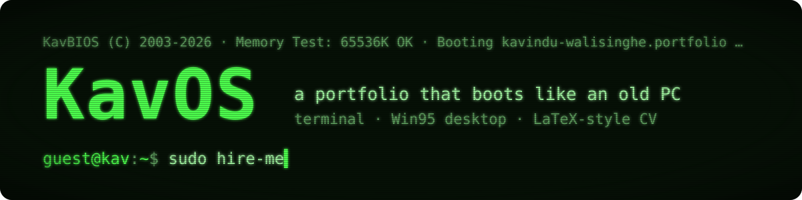
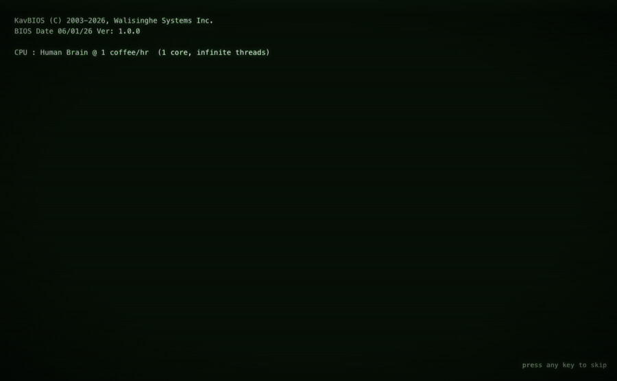
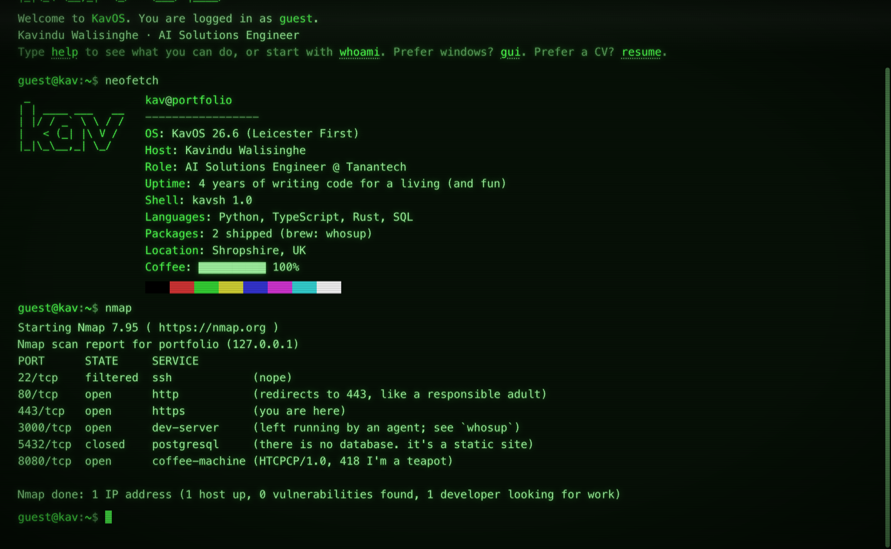
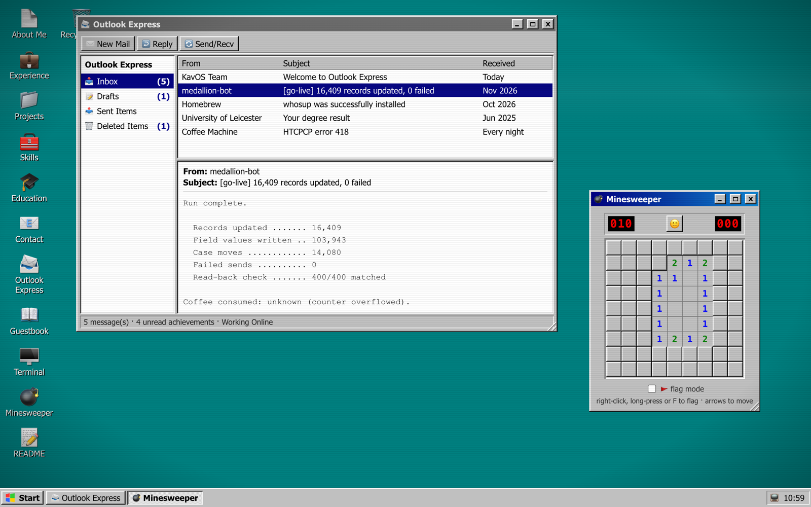
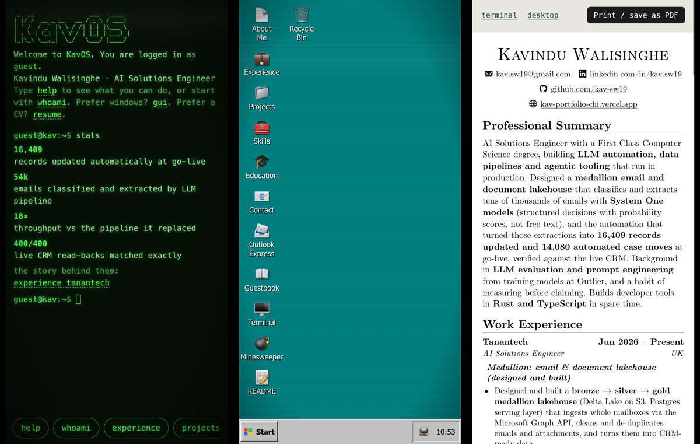
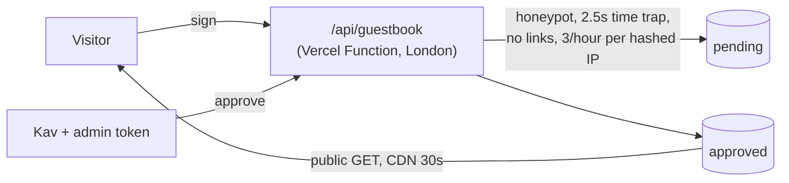

<h1>
  
</h1>

**A portfolio that boots like an old PC.** It does a CRT power-on, shows a BIOS screen and a GRUB menu, then gives you a choice: an interactive **terminal**, a working **Win95 desktop**, or a **LaTeX-style CV** that prints to two A4 pages.

[](https://kav-portfolio-chi.vercel.app)
[](#built-to-a-bar)
[](LICENSE)


<a href="docs/demo.mp4"></a>

**[→ Open it](https://kav-portfolio-chi.vercel.app)** · [Watch the MP4](docs/demo.mp4) · [Read the CV](https://kav-portfolio-chi.vercel.app/#plain)

## Three ways in

| Mode | Get there | What it is |
|---|---|---|
| **Terminal** | boot, `#terminal` | An interactive shell (`kavsh`) with tab completion, history, a virtual file system, five colour themes and clickable commands. On phones, quick-command chips sit above the keyboard. |
| **Desktop** | `gui`, `#desktop` | A Win95 window manager: drag, resize, minimise and maximise windows, a Start menu, a taskbar, and real apps. |
| **CV** | `resume`, `#plain` | The CV, typeset like its LaTeX original in Computer Modern. "Print / save as PDF" gives exactly two A4 pages. |

All three render from one file, [`src/data/profile.ts`](src/data/profile.ts). Change a line there and the terminal, the desktop windows, the CV and `/llms.txt` all update.

### The terminal



```text
guest@kav:~$ help          what you can do
guest@kav:~$ whoami        who this is
guest@kav:~$ experience    work history
guest@kav:~$ theme amber   green, amber, white, dracula, cyan
guest@kav:~$ gui           launch the desktop
guest@kav:~$ resume        open the CV
```

**Some commands are hidden.** Around seventy of them, aimed at people who like to probe a shell. Try the things you'd try on a box you don't own. None of them touch anything real; it's a static site. If you give up, `ls -a` has a hint.

### The desktop



| App | What it does |
|---|---|
| **About Me, Experience, Skills, Education** | Notepad windows over the same data as the CV |
| **Projects** | An Explorer window for each project |
| **Outlook Express** | A themed inbox. New Mail, Reply and the recruiter draft open the visitor's own mail app, already addressed. |
| **Guestbook** | Visitors sign it; entries appear after approval (see below) |
| **Terminal** | The full shell, in a window |
| **Minesweeper** | Real game: timer, flags, first click always safe, long-press to flag on touch, arrow-key play |
| **Recycle Bin** | Old files with something to say. It refuses to be emptied. |

### The CV

It follows Jake's résumé layout. The fonts are CMU Serif, cut down to the Latin characters (about 37 KB per weight) and served from the site itself. `@page` rules print exactly the CV on A4, with italic correction so slanted letters aren't clipped at the margin.

### On a phone



## Built to a bar

- **Lighthouse 100** for accessibility, best practices and SEO in every mode, on phone and desktop.
- **Keyboard first:**
  - GRUB uses roving focus.
  - Tab never gets trapped in the terminal.
  - The Start menu uses arrow keys and Escape.
  - Minesweeper uses arrow keys and F.
  - Focus moves to the next window when one closes, and to the top of the page when the mode changes.
- **Screen readers:**
  - Terminal output is a live log.
  - Decorative ASCII art is hidden or labelled.
  - Windows are labelled dialogs.
- **Touch:**
  - 24px+ hit areas on coarse pointers, and a single tap opens icons.
  - Safe areas are respected, and inputs are 16px so iOS doesn't zoom.
  - Hover styles apply only when a mouse is present.
- **Motion:**
  - The CRT power-on plays once per session.
  - The scanline is a compositor-only transform.
  - Window drags write to the DOM and commit to state once, on release.
  - Everything calms down under `prefers-reduced-motion`, and `crt off` disables the effects.
- **Resilience:**
  - Storage access never throws.
  - An error boundary falls back to the CV.
  - The Back button works across modes.
  - Nothing breaks when site data is blocked.
- **`/llms.txt` and `/robots.txt`** are generated at build time from the same profile data.

## The guestbook

Messages are approved before they appear. The only server code is one small Vercel Function, backed by Upstash Redis:



Messages always render as text, never HTML. IPs are stored only as a salted hash that expires after an hour. In local development the same handler runs inside Vite with an in-memory store, so `npm run dev` needs no database.

## Stack

React 19 · TypeScript · Vite · plain CSS (no UI library) · Vercel (static site and one function in `lhr1`) · Upstash Redis · CMU Serif (SIL OFL) · Bootstrap Icons (MIT)

```text
src/
  data/profile.ts        every word of content, in one place
  App.tsx                hash router, CRT shell, error boundary
  components/
    Boot.tsx, Grub.tsx   BIOS screen and boot menu
    Plain.tsx            the CV (plain.css: LaTeX look and print rules)
    desktop/             window manager and apps (Outlook, Guestbook, Recycle Bin, Minesweeper…)
  terminal/
    Terminal.tsx         the shell: input, history, completion, scrolling
    commands.tsx         documented commands
    eggs.tsx             the hidden ones
    fs.ts                the virtual file system
api/guestbook.ts         Vercel Function (Upstash, or in-memory in dev)
vite.config.ts           builds llms.txt and robots.txt, dev API middleware
```

## Run it

```sh
npm install
npm run dev          # http://localhost:5173 (guestbook admin token in dev: dev-admin)
npm run build        # → dist/
```

To deploy your own:
1. Import the repo into Vercel.
2. Add **Upstash for Redis** from the Storage tab. This sets `KV_REST_API_URL` and `KV_REST_API_TOKEN`.
3. Set `GUESTBOOK_ADMIN_TOKEN` and `GUESTBOOK_SALT` as sensitive environment variables.

Without Upstash, the guestbook shows "not connected yet" and everything else still works.

## Make it yours

Fork it and edit `src/data/profile.ts`: your bio, jobs, projects, skills and certifications. The terminal, the desktop windows, the CV and `llms.txt` all follow. The jokes live in `src/terminal/eggs.tsx` and `src/components/desktop/RecycleBin.tsx`.

## Licence

© 2026 Kavindu Walisinghe. [All rights reserved](LICENSE): the source is here to read, but the code, design and content may not be copied or reused without permission. The fonts are under the [SIL Open Font Licence](src/assets/fonts/OFL.txt) and Bootstrap Icons under MIT.
